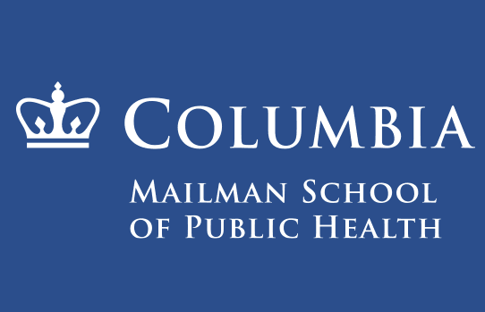
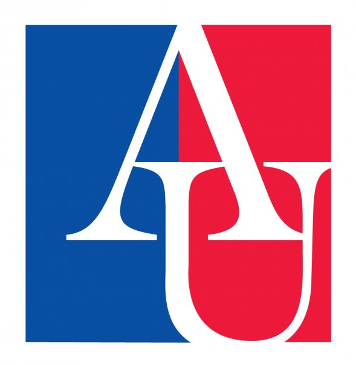

 

## Academic Background

* **Columbia University Mailman School of Public Health**, *New York, NY* 
    * **Master of Public Health, Epidemiology** (Expected May 2027)
    * **Certificate:** Epidemiology of Chronic Disease

 

* **American University**, *Washington, DC* 
    * **Bachelor of Science in Public Health** | Minor in Biology (May 2025)

 

* **Relevant Coursework:** 
  * **Data & Methods:** Analysis of Categorical Data, Applications of Epidemiological Research Methods, Data Science I, 
  * **Epidemiology:** Chronic Disease Epidemiology, Environmental Epidemiology, Epidemiology II: Design and Conduct of Observational Epidemiology, Principles of Epidemiology III: Applied Epidemiologic Analysis

 

## Professional Experience

* **Research Assistant**, Columbia University Mailman School of Public Health, Department of Epidemiology 
 
  *New York, NY | January 2026 – Present* 
    * Conduct literature reviews
    * Create DAGs to identify likely confounders, mediators, and effect modifiers in the     associations investigated
    * Clean data sets, calculate descriptive statistics, and conduct data analyses using Rstudio
    * Draft and revise research manuscripts
    * Communicate with collaborators and implement their comments and suggestions

 

* **Medical Office Assistant**, MedStar Washington Hospital Center 
 
  *Washington, D.C. | June 2024 – August 2025* 
    * Greeted patients, checked patients in, and managed patient appointments.
    * Received and screened telephone calls.
    * Communicated with providers, nurses, midwives, and medical assistants.
    * Completed preliminary registration for new patients and updated information on existing patients 
    * Ensured confidentiality and compliance with HIPAA regulations

 

* **Program Intern**, AHealthyU 
 
  *Washington, D.C. | January 2025 – May 2025* 
    * Assisted with coordinating well-being programs for faculty and staff
    * Drafted and contributed content to the weekly Wellness Monday newsletter
    * Assisted with AHealthyU Wellness Council meetings and events
    * Posted content to AhealthyU’s Facebook page
    * Tracked participation for various AHealthyU events and activities
    
 

## Skills
* **Data Cleaning and Analysis:** RStudio, SAS
* **Medical Operation Systems:** athenaIDX, MedConnect, Tonic for Health
* **Computer:** Microsoft Word, Excel, PowerPoint, and Forms; Google Workspace; 
* **Creative and Social Media:** Adobe Photoshop; Canva; Wix; Qualtrics